# 🥋 KaratePose-AI

**BSc (Hons) Research Project — Kinematic Refinement of Human Pose Estimation via a Physics-Informed Filter Engine for Elite Martial Arts Analytics**

> Investigating how rigid 14oz traditional Karate uniforms (Gi) degrade lightweight
> monocular pose estimation (**MediaPipe BlazePose** & **YOLOv8-Pose**), and introducing an
> **Event-Triggered Kinematic Extended Kalman Filter (EKF)** with Newtonian momentum projection
> and **de Leva (1996) Center of Gravity (CoG)** tracking to restore biomechanical fidelity.

---

## 📋 Research Framework (Two-Phase Architecture)

This research is structured into two distinct, decoupled phases corresponding to two academic papers:

```text
                      Raw Video Capture (Set A: Rashguard vs Set B: 14oz Gi)
                                                │
                                                ▼
                                    01_frame_extractor.py
                                    02_pose_inference.py
                                                │
                       ┌────────────────────────┴────────────────────────┐
                       ▼                                                 ▼
        [ PHASE 1: Paper 1 — The Problem ]              [ PHASE 2: Paper 2 — The Solution ]
        03_metrics.py (Jitter, Volatility, Angles)      07_ekf_filter.py (Event-Triggered EKF)
        04_aggregator.py (Anti-pseudoreplication)       09_cog_tracker.py (De Leva CoG Tracking)
        05_statistics.py (Wilcoxon, LMM, FDR)           10_filter_benchmark.py (MPJPE, PCK@0.2)
        08_visualiser.py (Paper 1 Figures)              Phase 2 Visualisation & Evaluation
```



```mermaid
flowchart LR
    subgraph Data["1. Video Capture"]
        direction TB
        A1["Set A: Control (Rashguard)"]
        A2["Set B: 14oz Canvas Gi"]
        A1 & A2 --> A["Dual-Stream Video<br/>(4K 60FPS / 240FPS)"]
    end

    subgraph Core["2. Shared Inference"]
        direction TB
        A --> B["01_frame_extractor.py<br/>(Frame extraction)"]
        B --> C["02_pose_inference.py<br/>(MediaPipe & YOLOv8)"]
        C --> D[("Landmarks CSV<br/>[frame, joint, x, y, conf]")]
    end

    subgraph P1["PHASE 1: Paper 1 — Degradation Analysis (The Problem)"]
        direction LR
        E1["03_metrics.py<br/>(Jitter & Angles)"] --> E2["04_aggregator.py<br/>(Anti-Pseudorep)"] --> E3["05_statistics.py<br/>(Wilcoxon, LMM)"] --> E4["08_visualiser.py<br/>(Paper 1 Plots)"]
    end

    subgraph P2["PHASE 2: Paper 2 — Kinematic Refinement & CoG (The Solution)"]
        direction LR
        F1["07_ekf_filter.py<br/>(Event-Triggered EKF)"] --> F2["09_cog_tracker.py<br/>(De Leva CoG)"] --> F3["10_filter_benchmark.py<br/>(MPJPE, PCK, Kime)"]
    end

    D --> E1
    D --> F1

    style Data fill:#263238,stroke:#455A64,stroke-width:1.5px,color:#ECEFF1
    style Core fill:#37474F,stroke:#607D8B,stroke-width:1.5px,color:#ECEFF1
    style P1 fill:#0D47A1,stroke:#1E88E5,stroke-width:1.5px,color:#FFFFFF
    style P2 fill:#004D40,stroke:#00897B,stroke-width:1.5px,color:#FFFFFF
```

### Phase 1: Benchmark & Degradation Quantification (Paper 1)
- **Controlled Independent Variable:** Tight compression wear (Set A) vs. 14oz rigid canvas Karate Gi (Set B).
- **Cohort:** Multi-practitioner ($N=3$), stratified by skill level (1st Dan to 4th Dan, including Asian Championship winner).
- **Degradation Metrics:** Spatial Jitter ($J_t$), Confidence Volatility ($V_c$), and anatomical Joint Angles.
- **Statistical Rigour:** Per-repetition aggregation to eliminate pseudoreplication, non-parametric Wilcoxon signed-rank tests, Benjamini-Hochberg FDR correction ($q=0.05$), and Linear Mixed-Effects Models (LMM).

### Phase 2: Physics-Informed Filter Engine & Biomechanics (Paper 2)
- **Event-Triggered Kinematic EKF:** 6-state constant-acceleration Newtonian model ($[x, y, \dot{x}, \dot{y}, \ddot{x}, \ddot{y}]^T$) operating at 60 FPS ($\Delta t = 1/60\text{s}$).
- **Confidence-Gated Measurement Update:** Dynamic scaling of measurement noise covariance:
  $$R_t = \sigma_0^2 \cdot \exp\bigl(\gamma(1 - c_t)\bigr) \cdot I_2$$
- **Momentum Projection with Adaptive Damping:** Predict-only trajectory coasting through occlusion gaps with adaptive deceleration, mitigating drift during extended folds while preserving genuine ballistic impulse (*Kime*).
- **Segmental Center of Gravity Engine:** Synthesis of filtered coordinates with de Leva's (1996) 14-segment mass distribution parameters and dynamic stance depth tracking.

---

## 🏗️ Project Structure

```
Karate Pose AI/
├── src/                        # Source code modules
│   ├── config.py               # Central configuration (paths, joints, EKF params, de Leva weights)
│   │
│   │   # ── SHARED FOUNDATION ────────────────────────────
│   ├── 01_frame_extractor.py   # Video → frame extraction with metadata validation
│   ├── 02_pose_inference.py    # MediaPipe Tasks API + YOLOv8x-Pose inference
│   │
│   │   # ── PHASE 1 (Paper 1: The Degradation Problem) ───
│   ├── 03_metrics.py           # Spatial jitter, confidence volatility, joint angles
│   ├── 04_aggregator.py        # Frame → repetition aggregation (anti-pseudoreplication)
│   ├── 05_statistics.py        # Wilcoxon, paired t-test, LMM, FDR correction
│   ├── 06_video_overlay.py     # Side-by-side skeleton visualizer
│   ├── 08_visualiser.py        # Publication-ready plots for Paper 1
│   │
│   │   # ── PHASE 2 (Paper 2: The EKF & CoG Solution) ────
│   ├── 07_ekf_filter.py        # Event-triggered kinematic EKF (4 modes + ablation toggles)
│   ├── 09_cog_tracker.py       # De Leva (1996) biomechanical CoG & stance depth engine
│   ├── 10_filter_benchmark.py  # MPJPE, PCK@0.2, phase lag, & velocity preservation benchmark
│   │
│   │   # ── UTILITIES ─────────────────────────────────────
│   └── rep_detector.py         # Velocity-based automatic repetition segmentation
│
├── data/
│   ├── landmarks/              # Intermediate pose detection CSVs
│   ├── raw/                    # Real experimental recordings (Set A / Set B / Calibration)
│   └── sample/                 # Sample test videos (e.g. test_oizuki.mp4)
│
├── docs/
│   ├── Phase_2_Plan.md         # Comprehensive Phase 2 architecture & roadmap
│   ├── Paper_1_Draft.md        # Manuscript 1 draft
│   ├── Video_Recording_Guide.md# Protocol for 4K 60FPS / 240FPS video capture
│   └── protocol/               # Printable & digital data collection sheets
│
├── output/
│   ├── filtered/               # EKF filtered coordinates & diagnostics CSVs
│   ├── cog/                    # Center of Gravity & stance trajectories
│   ├── benchmark/              # Filter comparison results (MPJPE, PCK, phase lag)
│   ├── metrics/                # Jitter & volatility CSVs
│   ├── statistics/             # Inferential test results
│   └── plots/                  # Publication figures
│
├── run_pipeline.py             # Main CLI orchestrator (--phase 1 / --phase 2)
├── run_demo.py                 # Quick demo with synthetic data
├── requirements.txt            # Python dependencies
└── .gitignore
```

---

## 🚀 Quick Start

### Prerequisites
- Python 3.12+ (tested on 3.14)
- macOS (Apple Silicon M1–M4) or Windows (CUDA optional)

### Setup
```bash
# 1. Clone the repository
git clone https://github.com/kusalxn0506/KaratePose-AI.git
cd KaratePose-AI

# 2. Create a virtual environment
python3 -m venv .venv
source .venv/bin/activate      # macOS/Linux
# .venv\Scripts\activate       # Windows

# 3. Install dependencies
pip install -r requirements.txt

# 4. Download AI model weights (not included in repo)
# MediaPipe Pose Landmarker (Heavy — 29 MB)
curl -L -o pose_landmarker_heavy.task \
  "https://storage.googleapis.com/mediapipe-models/pose_landmarker/pose_landmarker_heavy/float16/1/pose_landmarker_heavy.task"

# YOLOv8x-Pose (133 MB — auto-downloads on first run)
```

### Run

#### Phase 1: Pose Inference & Degradation Metrics
```bash
# Run the full Phase 1 pipeline on the sample video
python run_pipeline.py --sample

# Or run individual Phase 1 steps
python run_pipeline.py --step extract --sample
python run_pipeline.py --step inference --sample
python run_pipeline.py --step metrics --sample
python run_pipeline.py --step aggregate --sample

# Watch the skeleton overlay
python -m src.06_video_overlay
```

#### Phase 2: Event-Triggered Kinematic EKF & CoG
```bash
# Run the full Phase 2 pipeline (filter → CoG → benchmark)
python run_pipeline.py --phase 2

# Or run individual Phase 2 steps
python run_pipeline.py --phase 2 --step filter      # All 4 filter modes on landmarks
python run_pipeline.py --phase 2 --step cog          # De Leva CoG from filtered output
python run_pipeline.py --phase 2 --step benchmark    # MPJPE, PCK@0.2, phase lag comparison

# With calibration scale for stance depth in metres
python run_pipeline.py --phase 2 --step cog --scale 1920

# Or run modules standalone
python -m src.07_ekf_filter                          # EKF standalone test
python -m src.09_cog_tracker                         # CoG standalone batch
```

#### Utility: Automatic Repetition Segmentation
```bash
# Detect rep boundaries from landmark CSV (self-paced protocol)
python -m src.rep_detector --input data/landmarks/FILE_landmarks.csv --technique OIZUKI

# Specify expected reps (default: 10)
python -m src.rep_detector --input data/landmarks/FILE_landmarks.csv --technique GEDAN --n-reps 10
```

---

## 📦 Dependencies

| Package | Version | Purpose |
|---------|---------|---------|
| `mediapipe` | 0.10.35 | Pose estimation (33 landmarks) |
| `ultralytics` | ≥8.0.0 | YOLOv8-Pose (17 keypoints) |
| `opencv-python` | ≥4.8.0 | Video I/O and image processing |
| `pandas` | ≥2.0.0 | Data manipulation |
| `numpy` | ≥1.24.0 | Numerical computing |
| `scipy` | ≥1.11.0 | Statistical tests |
| `pingouin` | ≥0.5.3 | Effect sizes (rank-biserial) |
| `statsmodels` | ≥0.14.0 | Linear Mixed-Effects Models |
| `matplotlib` | ≥3.7.0 | Plotting |
| `seaborn` | ≥0.12.0 | Statistical visualisation |

> ⚠️ **macOS Note:** MediaPipe must be pinned to `v0.10.35`. Version 1.0.x crashes
> on Apple Silicon due to a Metal GPU bug in `TensorsToDetectionsCalculator`.

---

## 📄 License

This project is part of a BSc (Hons) research study. All rights reserved.

---

## 👤 Author

**Kusal Nirmala**  
*BSc (Hons) Artificial Intelligence*  
*NSBM Green University / University of Plymouth*
