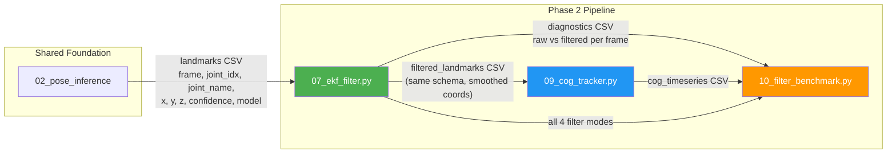

# KaratePose-AI — Phase 2 Definitive Build Architecture

> **Status**: ✅ AGREED — Ready to build  
> **Last updated**: 2026-10-24  
> **Build order**: `07_ekf_filter.py` → `09_cog_tracker.py` → `10_filter_benchmark.py` → pipeline integration

---

## Final File Structure

```
Karate Pose AI/
├── src/
│   ├── config.py                    ← Minor additions (COG segment map, benchmark config)
│   ├── 01_frame_extractor.py        ──┐
│   ├── 02_pose_inference.py         ──┴── SHARED FOUNDATION (both phases)
│   │
│   │   # ─── PHASE 1 (Paper 1: The Degradation Problem) ── FROZEN ──
│   ├── 03_metrics.py                (Jitter & Confidence Volatility)
│   ├── 04_aggregator.py             (Trial Aggregation & Anti-Pseudoreplication)
│   ├── 05_statistics.py             (Wilcoxon, LMM, FDR Correction)
│   ├── 06_video_overlay.py          (Video overlay rendering)
│   ├── 08_visualiser.py             (Publication plots for Paper 1)
│   │
│   │   # ─── PHASE 2 (Paper 2: The EKF & CoG Solution) ── NEW ──
│   ├── 07_ekf_filter.py             (Event-Triggered Kinematic EKF)        ← BUILD DAY 1
│   ├── 09_cog_tracker.py            (De Leva Biomechanical CoG Engine)     ← BUILD DAY 2
│   └── 10_filter_benchmark.py       (EKF vs SKF vs Interp vs Raw)         ← BUILD DAY 3
│
├── run_pipeline.py                  ← Extended with --phase 2 support
└── output/
    ├── filtered/                    ← EKF output (already in PATHS)
    ├── cog/                         ← CoG output (already in PATHS)
    └── benchmark/                   ← NEW: comparison tables & plots
```

> [!IMPORTANT]
> **Rule**: Modules 01–06 and 08 are **never modified**. Phase 2 modules (07, 09, 10) only import from `config.py` and consume landmark CSVs produced by module 02. Zero dependency on modules 03–05.

---

## Data Flow Contract



### CSV Schemas

**Input** (from 02, unchanged):
```
frame, joint_idx, joint_name, x, y, z, confidence, model
```

**Filtered landmarks** (output of 07):
```
frame, joint_idx, joint_name, x, y, z, confidence, model, filter_mode,
filtered_x, filtered_y, event_triggered, kalman_gain_norm
```

**CoG timeseries** (output of 09):
```
frame, cog_x, cog_y, stance_depth_m, model, filter_mode
```

**Benchmark summary** (output of 10):
```
model, filter_mode, joint_name, mpjpe, pck_at_02, phase_lag_frames,
peak_velocity_preservation_ratio
```

---

## Module 1: `07_ekf_filter.py` — Event-Triggered Kinematic EKF

### Theory (Proposal §6.6)

**State vector** per joint: $\mathbf{x}_t = [x, y, \dot{x}, \dot{y}, \ddot{x}, \ddot{y}]^T$

**Transition** (constant-acceleration Newtonian model):
$$\mathbf{x}_t = F \cdot \mathbf{x}_{t-1} + \mathbf{w}_t$$

**Confidence-gated measurement noise**:
$$R_t = \sigma_0^2 \cdot \exp\bigl(\gamma(1 - c_t)\bigr) \cdot I_2$$

**Event trigger**: 
- $c_t \geq T_\text{thresh}$ → standard Kalman update
- $c_t < T_\text{thresh}$ → predict-only (momentum projection through occlusion)

### Functions

```python
# ── Core EKF Math ──
def build_transition_matrix(dt: float) -> np.ndarray:
    """6×6 constant-acceleration state transition matrix F."""

def build_process_noise(dt: float, sigma_a: float) -> np.ndarray:
    """6×6 process noise Q via continuous white-noise jerk model."""

def compute_dynamic_R(confidence: float, sigma_0: float, gamma: float) -> np.ndarray:
    """2×2 measurement noise R_t, exponentially scaled by confidence."""

# ── Single-Joint Filter ──
def run_ekf_single_joint(
    xs: np.ndarray, ys: np.ndarray, confs: np.ndarray,
    dt: float, sigma_0: float, gamma: float, threshold: float
) -> dict:
    """Full EKF loop for one joint. Returns filtered coords + diagnostics."""

# ── Baseline Filters (for comparison in module 10) ──
def run_standard_kalman(xs, ys, confs, dt, sigma_0) -> dict:
    """Continuous Standard Kalman Filter — constant R, no gating."""

def run_linear_interpolation(xs, ys, confs, threshold) -> dict:
    """Linear interp across low-confidence gaps."""

# ── Orchestrator ──
def run_filter(
    landmarks_df: pd.DataFrame,
    model_name: str = "mediapipe",
    filter_mode: str = "ekf",       # "raw" | "skf" | "linear_interp" | "ekf"
    config: dict = None,
    # Ablation toggles (§6.7)
    use_confidence_gating: bool = True,
    use_momentum_projection: bool = True,
    use_event_trigger: bool = True,
) -> tuple[pd.DataFrame, pd.DataFrame]:
    """
    Filters all joints. Returns (filtered_landmarks_df, diagnostics_df).
    Processes both MediaPipe and YOLOv8 landmarks.
    """

def save_filtered_landmarks(df: pd.DataFrame, output_dir: Path) -> Path:
def save_diagnostics(df: pd.DataFrame, output_dir: Path) -> Path:
```

### Ablation Variants (§6.7)

| Variant | `use_confidence_gating` | `use_momentum_projection` | `use_event_trigger` |
|:--------|:-----------------------:|:-------------------------:|:-------------------:|
| Confidence Gating Only | ✅ | ❌ | ❌ |
| Momentum Projection Only | ❌ | ✅ | ✅ |
| No Event Triggering | ✅ | ❌ | ❌ (continuous dynamic R) |
| **Full System** | ✅ | ✅ | ✅ |

---

## Module 2: `09_cog_tracker.py` — De Leva CoG Engine

### Theory (Proposal §6.6.4)

$$X_\text{CoG} = \sum_i w_i \cdot x_i, \quad Y_\text{CoG} = \sum_i w_i \cdot y_i$$

$$D_\text{stance} = |x_\text{ankle\_lead} - x_\text{ankle\_rear}| \times S_{px}^{-1}$$

### Segment → Joint Mapping (MediaPipe indices)

| Segment | Proximal | Distal | Weight |
|:--------|:---------|:-------|:-------|
| head_neck | nose (0) | midpoint(11,12) | 0.0681 |
| trunk | midpoint(11,12) | midpoint(23,24) | 0.4346 |
| L upper_arm | 11 | 13 | 0.0263 |
| R upper_arm | 12 | 14 | 0.0263 |
| L forearm | 13 | 15 | 0.0150 |
| R forearm | 14 | 16 | 0.0150 |
| L hand | 15 | 15 (wrist proxy) | 0.0059 |
| R hand | 16 | 16 (wrist proxy) | 0.0059 |
| L thigh | 23 | 25 | 0.1416 |
| R thigh | 24 | 26 | 0.1416 |
| L shank | 25 | 27 | 0.0433 |
| R shank | 26 | 28 | 0.0433 |
| L foot | 27 | 31 | 0.0137 |
| R foot | 28 | 32 | 0.0137 |

### Functions

```python
def get_segment_definitions(model_name: str = "mediapipe") -> list[dict]:
    """Returns segment definitions with joint indices and de Leva weights."""

def compute_segment_cog(frame_data: dict, segments: list[dict]) -> dict:
    """Segment midpoints for a single frame."""

def compute_global_cog(segment_cogs: dict, weights: dict) -> tuple[float, float]:
    """Mass-weighted global CoG (x, y)."""

def compute_stance_depth(frame_data: dict, scale_factor: float) -> float:
    """Horizontal ankle separation in meters."""

def run_cog_pipeline(
    filtered_df: pd.DataFrame,
    model_name: str = "mediapipe",
    scale_factor: float = None,      # pixels/meter from calibration
    filter_mode: str = "ekf"
) -> pd.DataFrame:
    """Full pipeline → CoG timeseries DataFrame."""

def save_cog_data(df: pd.DataFrame, output_dir: Path) -> Path:
```

---

## Module 3: `10_filter_benchmark.py` — Comparative Evaluation

### Metrics (Proposal §6.6.5)

| Metric | Formula | What It Tests |
|:-------|:--------|:--------------|
| MPJPE | Mean Per Joint Position Error vs Set A proxy GT | Accuracy |
| PCK@0.2 | % keypoints within 20% torso diameter | Correctness |
| Phase Lag | Cross-correlation peak offset (frames) | Kime preservation |
| Peak Velocity Preservation | $v_\text{peak,filtered} / v_\text{peak,raw\_setA}$ | Ballistic fidelity |

### Comparison Matrix

| | Raw (Set B) | Linear Interp | Standard KF | **Event-Triggered EKF** |
|:--|:-:|:-:|:-:|:-:|
| MPJPE | baseline | — | — | **expected best** |
| PCK@0.2 | baseline | — | — | **expected best** |
| Phase Lag | 0 | low | **high** | **~0** |
| Peak Vel. Preservation | 1.0 | low | **low** | **~1.0** |

### Functions

```python
def compute_mpjpe(filtered_df, ground_truth_df, model_name) -> pd.DataFrame:
def compute_pck(filtered_df, ground_truth_df, model_name, threshold=0.2) -> pd.DataFrame:
def compute_phase_lag(filtered_df, ground_truth_df, joint_name) -> float:
def compute_peak_velocity_ratio(filtered_df, ground_truth_df, joint_name) -> float:

def run_full_benchmark(
    landmarks_set_a: pd.DataFrame,    # proxy ground truth
    landmarks_set_b: pd.DataFrame,    # occluded data
    model_name: str = "mediapipe",
    config: dict = None
) -> pd.DataFrame:
    """Runs all 4 filter modes on Set B, evaluates against Set A."""

def generate_benchmark_plots(results_df, output_dir) -> list[Path]:
def save_benchmark_results(results_df, output_dir) -> Path:
```

---

## Config Additions (Minimal)

```python
# Added to config.py — Section 9 extension
EKF_CONFIG = {
    # ... existing entries stay ...
    "sigma_a":              1.0,    # Process noise acceleration std (for Q matrix)
}

# NEW Section 12: Segment definitions for CoG
COG_SEGMENT_MAP_MP = { ... }   # The 14-segment table above
COG_SEGMENT_MAP_YOLO = { ... } # Equivalent for YOLO indices

# NEW Section 13: Benchmark config
BENCHMARK_CONFIG = {
    "pck_threshold": 0.2,           # PCK normalised by torso diameter
    "filter_modes": ["raw", "skf", "linear_interp", "ekf"],
}

# PATHS addition
PATHS["benchmark"] = PROJECT_ROOT / "output" / "benchmark"
```

---

## Pipeline Runner Extension

```python
# run_pipeline.py additions
parser.add_argument("--phase", type=int, default=None, choices=[1, 2])
parser.add_argument("--step", ..., choices=[
    ...,  # existing Phase 1 steps
    "filter", "cog", "benchmark"  # Phase 2 steps
])

# Phase 2 steps:
# --phase 2 --step filter     →  07_ekf_filter on landmark CSVs
# --phase 2 --step cog        →  09_cog_tracker on filtered output
# --phase 2 --step benchmark  →  10_filter_benchmark (full comparison)
# --phase 2                   →  all three in sequence
```

---

## Build Schedule

| Session | Module | Estimated Complexity | Deliverable |
|:--------|:-------|:---------------------|:------------|
| **Day 1** | `07_ekf_filter.py` | 🔴 Heavy | Complete EKF with 4 modes + ablation + synthetic test |
| **Day 2** | `09_cog_tracker.py` | 🟡 Medium | CoG engine + stance depth + integration with EKF output |
| **Day 3** | `10_filter_benchmark.py` + pipeline | 🟡 Medium | MPJPE/PCK/phase-lag evaluation + `run_pipeline.py --phase 2` |

> [!TIP]
> **Day 1 is the critical path.** The EKF is the paper's primary algorithmic contribution. Days 2–3 are downstream consumers that are simpler once the EKF produces clean filtered CSVs.

---

*Tomorrow → start with `07_ekf_filter.py`* 🥋
